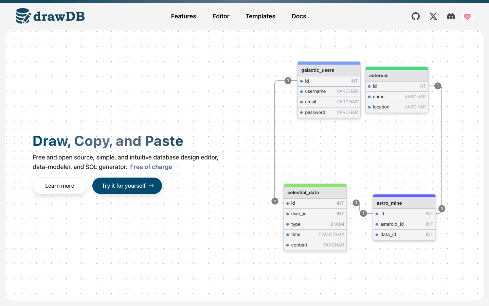
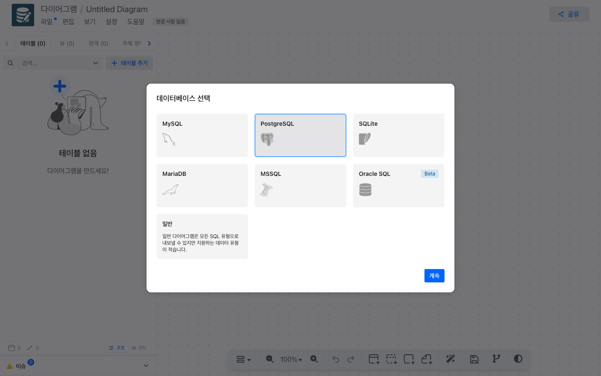
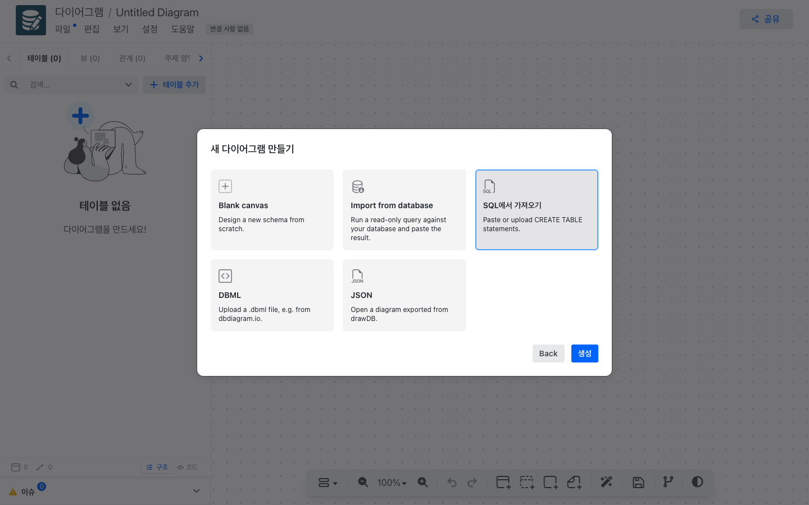
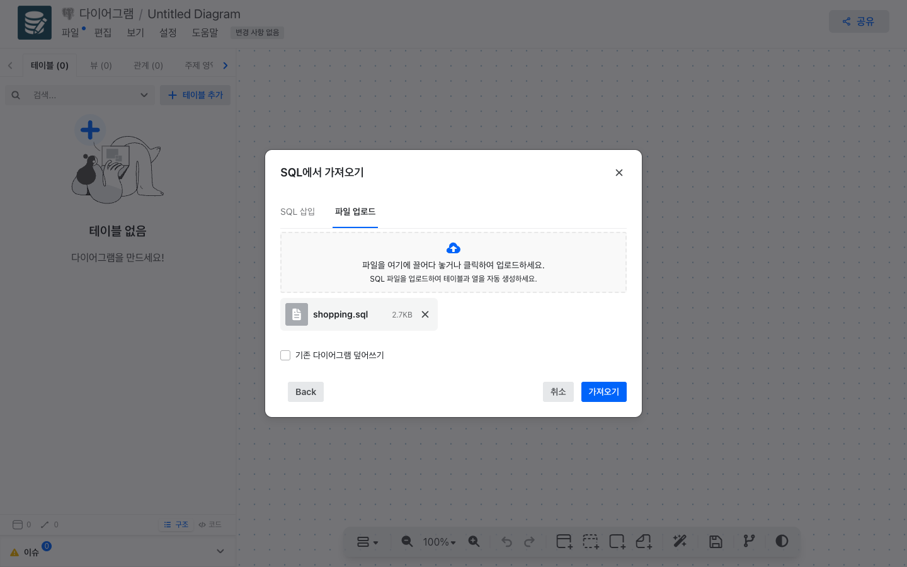
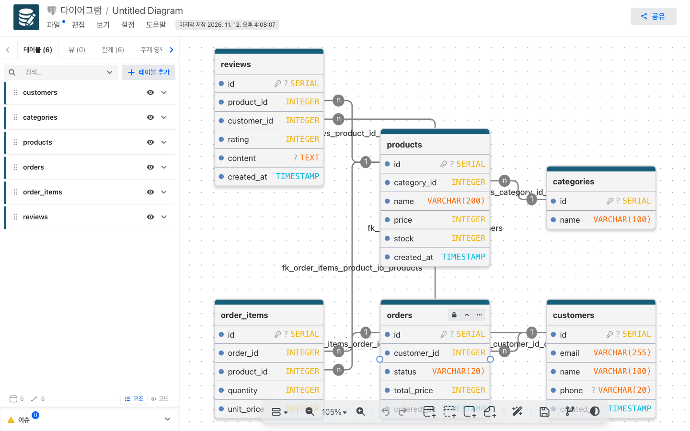

# drawDB 로컬 설치 가이드

Node 설치부터 drawDB를 Docker로 띄우고, Postgres 쇼핑몰 시드 테이블을 drawDB ERD로 가져오는 과정까지 다룹니다. (Windows / macOS)

## 1. Node 설치

```bash
# macOS
brew install node git

# Windows (PowerShell)
winget install OpenJS.NodeJS.LTS
winget install Git.Git
```

```bash
node -v   # v22 이상
```

## 2. drawDB 설치

```bash
git clone https://github.com/woogi-kang/drawdb-local-guide.git
cd drawdb-local-guide
git clone --depth 1 https://github.com/drawdb-io/drawdb.git drawdb
cd drawdb
npm ci
npm run dev
```

http://localhost:5173 에 접속해서 화면이 뜨면 성공입니다.



`Ctrl + C`로 개발 서버를 끈 뒤, Docker에서 쓸 빌드 파일을 만듭니다.

```bash
npm run build
cd ..   # drawdb-local-guide 폴더로 돌아오기
```

## 3. Docker로 실행

[Docker Desktop](https://www.docker.com/products/docker-desktop/)을 실행한 상태에서, `compose.yml`이 있는 **`drawdb-local-guide` 폴더**에서 실행합니다. (`drawdb` 폴더 안이 아닙니다)

```bash
docker compose up -d --build
```

- drawDB (`nginx:latest`): http://localhost:8080
- Postgres (`postgres:latest`): `localhost:15432`

## 4. Postgres 연결

| 항목 | 값 |
| --- | --- |
| Host | `localhost` |
| Port | `15432` |
| Database / User / Password | `shop` / `shop` / `shop` |

DBeaver·TablePlus 같은 GUI 도구에서 위 정보로 접속하거나, 터미널에서 바로 접속합니다.

```bash
docker exec -it drawdb-postgres psql -U shop -d shop
```

## 5. 시드 테이블 생성

테이블 6개(회원, 카테고리, 상품, 주문, 주문상세, 리뷰)와 샘플 데이터가 들어 있습니다.

**방법 A. 파일 다운로드**

[shopping.sql 다운로드](https://raw.githubusercontent.com/woogi-kang/drawdb-local-guide/main/seed/shopping.sql)를 받은 뒤, 받은 폴더에서 실행합니다.

```bash
docker cp shopping.sql drawdb-postgres:/shopping.sql
docker exec drawdb-postgres psql -U shop -d shop -f /shopping.sql
```

**방법 B. SQL 직접 입력**

4단계의 `psql` 접속 화면이나 GUI 도구에 아래 SQL을 붙여넣습니다.

<details>
<summary>shopping.sql 펼치기</summary>

```sql
-- 쇼핑몰 시드 (PostgreSQL)
-- psql 로 실행하면 테이블+데이터 생성, drawDB 로 가져오면 ERD 생성

CREATE TABLE customers (
    id          SERIAL PRIMARY KEY,
    email       VARCHAR(255) NOT NULL UNIQUE,
    name        VARCHAR(100) NOT NULL,
    phone       VARCHAR(20),
    created_at  TIMESTAMP NOT NULL DEFAULT CURRENT_TIMESTAMP
);

CREATE TABLE categories (
    id          SERIAL PRIMARY KEY,
    name        VARCHAR(100) NOT NULL UNIQUE
);

CREATE TABLE products (
    id           SERIAL PRIMARY KEY,
    category_id  INTEGER NOT NULL,
    name         VARCHAR(200) NOT NULL,
    price        INTEGER NOT NULL,
    stock        INTEGER NOT NULL DEFAULT 0,
    created_at   TIMESTAMP NOT NULL DEFAULT CURRENT_TIMESTAMP,
    FOREIGN KEY (category_id) REFERENCES categories (id)
);

CREATE TABLE orders (
    id           SERIAL PRIMARY KEY,
    customer_id  INTEGER NOT NULL,
    status       VARCHAR(20) NOT NULL DEFAULT 'PENDING',
    total_price  INTEGER NOT NULL DEFAULT 0,
    ordered_at   TIMESTAMP NOT NULL DEFAULT CURRENT_TIMESTAMP,
    FOREIGN KEY (customer_id) REFERENCES customers (id)
);

CREATE TABLE order_items (
    id          SERIAL PRIMARY KEY,
    order_id    INTEGER NOT NULL,
    product_id  INTEGER NOT NULL,
    quantity    INTEGER NOT NULL,
    unit_price  INTEGER NOT NULL,
    FOREIGN KEY (order_id) REFERENCES orders (id),
    FOREIGN KEY (product_id) REFERENCES products (id)
);

CREATE TABLE reviews (
    id           SERIAL PRIMARY KEY,
    product_id   INTEGER NOT NULL,
    customer_id  INTEGER NOT NULL,
    rating       INTEGER NOT NULL,
    content      TEXT,
    created_at   TIMESTAMP NOT NULL DEFAULT CURRENT_TIMESTAMP,
    FOREIGN KEY (product_id) REFERENCES products (id),
    FOREIGN KEY (customer_id) REFERENCES customers (id)
);

INSERT INTO customers (email, name, phone) VALUES
('kim@example.com',  '김민수', '010-1111-2222'),
('lee@example.com',  '이서연', '010-3333-4444'),
('park@example.com', '박지훈', NULL);

INSERT INTO categories (name) VALUES
('의류'), ('전자기기'), ('식품');

INSERT INTO products (category_id, name, price, stock) VALUES
(1, '기본 반팔 티셔츠', 19000, 120),
(1, '데님 청바지',      49000,  40),
(2, '무선 이어폰',      89000,  25),
(2, '보조배터리 10000mAh', 29000, 60),
(3, '유기농 원두 1kg',  32000,  30);

INSERT INTO orders (customer_id, status, total_price) VALUES
(1, 'PAID',     68000),
(2, 'SHIPPED',  89000),
(1, 'PENDING',  32000);

INSERT INTO order_items (order_id, product_id, quantity, unit_price) VALUES
(1, 1, 1, 19000),
(1, 2, 1, 49000),
(2, 3, 1, 89000),
(3, 5, 1, 32000);

INSERT INTO reviews (product_id, customer_id, rating, content) VALUES
(1, 1, 5, '핏이 좋아요'),
(3, 2, 4, '음질 괜찮고 배터리 오래가요');
```

</details>

확인:

```bash
docker exec drawdb-postgres psql -U shop -d shop -c "\dt"
```

## 6. drawDB에 넣기

1. http://localhost:8080/editor 에 접속해 **PostgreSQL** → **계속**을 누릅니다.

   

2. **SQL에서 가져오기** → **생성**을 누릅니다.

   

3. **파일 업로드** 탭에서 `shopping.sql`을 선택하고 **가져오기**를 누릅니다. (SQL 삽입 탭에 붙여넣어도 됩니다)

   

4. 테이블 6개와 관계 6개가 그려집니다.

   
